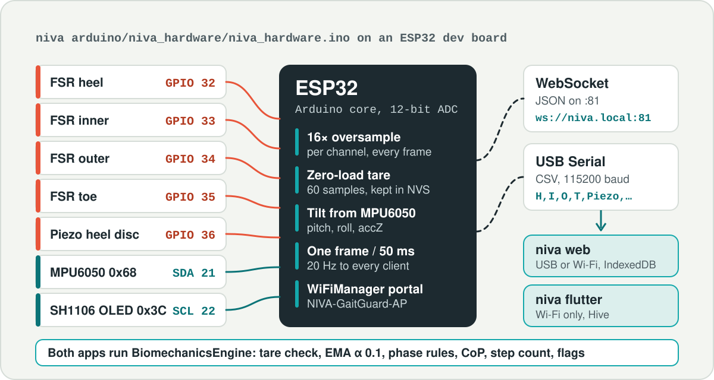
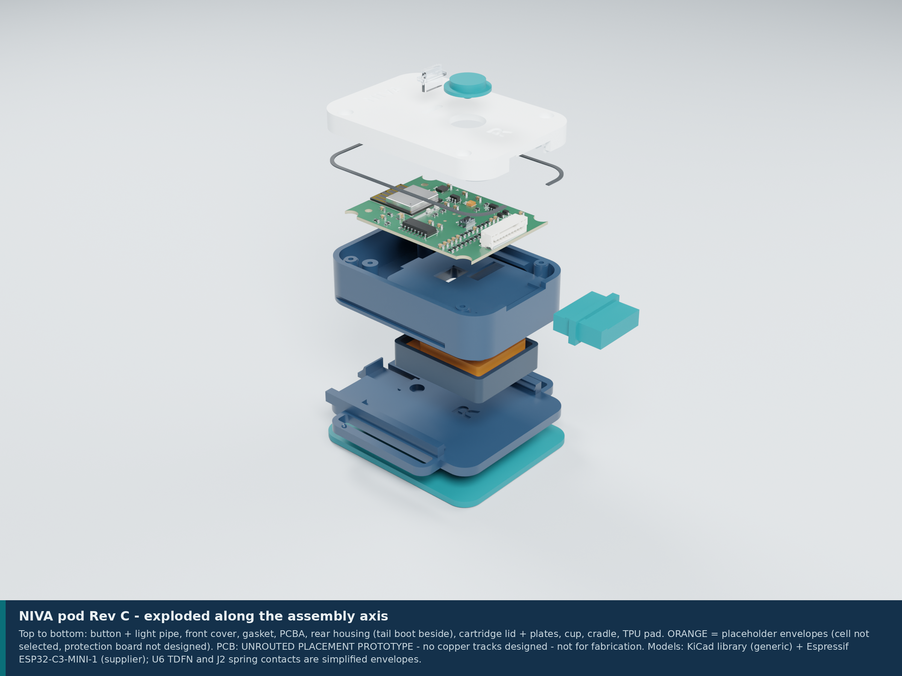
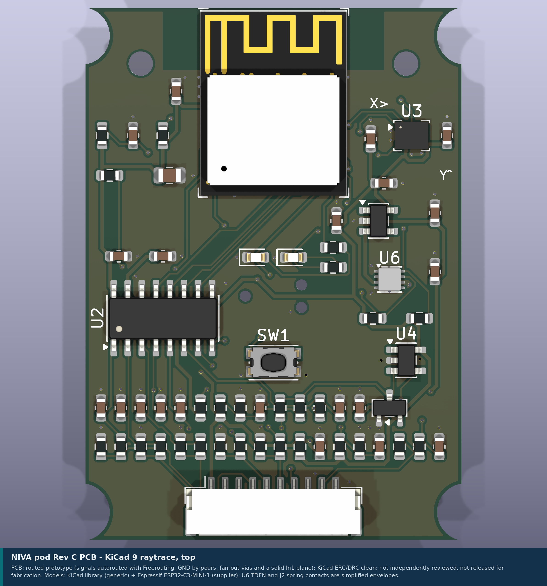
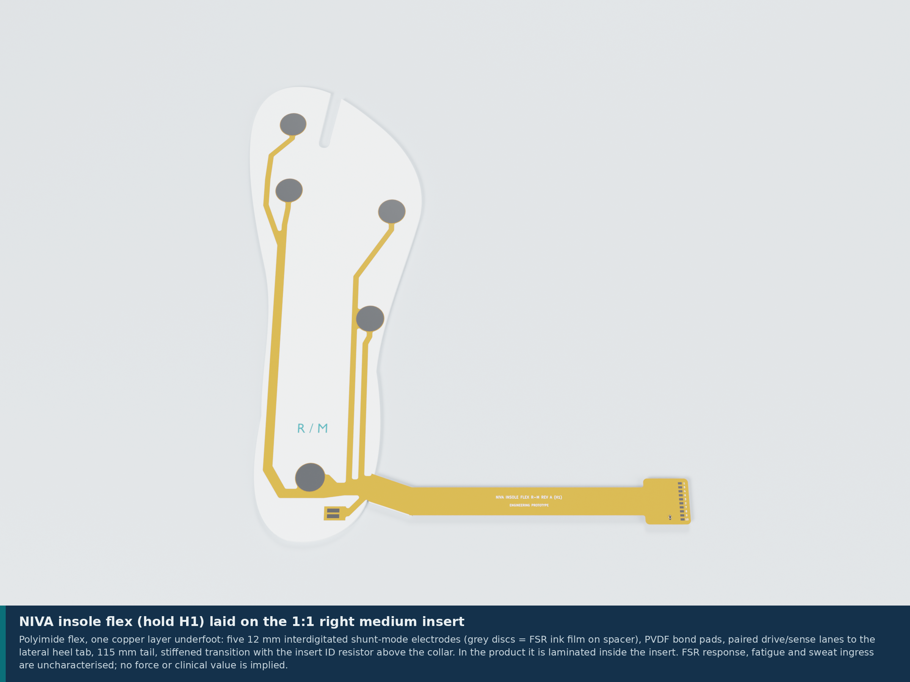
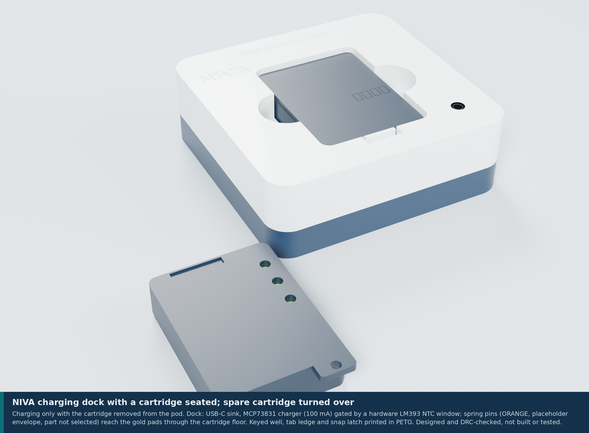
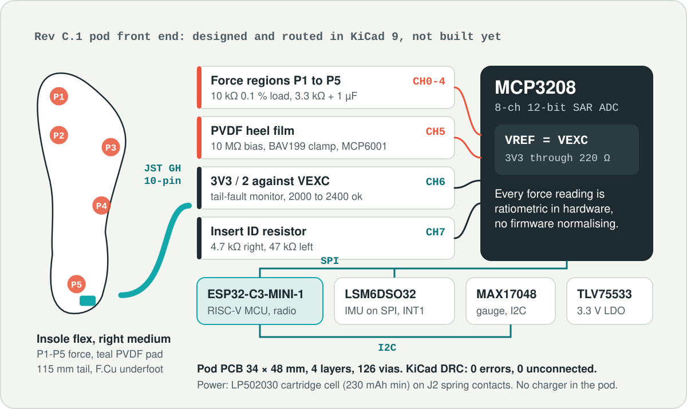

<p align="center">
  
</p>

<p align="center">
  <a href="https://https-shubhamsahu.github.io/niva/"><b>Live dashboard</b></a> ·
  <a href="./startup/niva%20arduino/README.md">Firmware</a> ·
  <a href="./hardware/outputs/NIVA-3D-engineering-prototype/README.md">Rev C.1 hardware</a> ·
  <a href="./startup/niva%20web/src/utils/biomechanicsEngine.ts">Scoring rules</a>
</p>

> Three projects share this insole: the Niva startup, the Aavishkar 2026–27 research entry, and the SIH 2026 problem statement 26213. See [PROJECTS.md](PROJECTS.md) for what belongs to which.

Niva is a smart insole for gait screening. An ESP32 reads four force pads, a piezo disc under the heel and an MPU6050, then streams 20 frames a second to a React dashboard and a Flutter app. Each gait phase, score and alert comes from a threshold in one TypeScript file, so you can point at the exact reading that set off an alert. Niva was shown at Automation Expo in July 2026.

> **Status:** the bench build runs today. The Rev C.1 wearable pod is designed, routed and DRC-clean in KiCad, but it hasn't been built or measured yet. Niva is a research and screening prototype. It isn't a medical device.

## Bench build

<p align="center">
  
</p>

The active sketch is [`startup/niva arduino/niva_hardware/niva_hardware.ino`](./startup/niva%20arduino/niva_hardware/niva_hardware.ino).

| Signal | ESP32 pin | Notes |
|---|---|---|
| FSR heel | GPIO 32 | ADC1_CH4 |
| FSR inner (1st metatarsal) | GPIO 33 | ADC1_CH5 |
| FSR outer (5th metatarsal) | GPIO 34 | ADC1_CH6 |
| FSR toe | GPIO 35 | ADC1_CH7 |
| Piezo heel disc | GPIO 36 | ADC1_CH0, the impact channel |
| I2C SDA | GPIO 21 | MPU6050 at `0x68`, SH1106 OLED at `0x3C` |
| I2C SCL | GPIO 22 | shared bus |
| Status LED | GPIO 2 | blinks during tare |

What the firmware does each frame:

- reads every ADC channel 16 times at 12 bits and averages the result
- subtracts a zero-load tare (60 samples, saved in NVS, redone when you send `calibrate` or `tare` over WebSocket or Serial)
- reads pitch, roll and accZ from the MPU6050
- sends one frame every 50 ms to your WebSocket clients and the USB port
- shows Wi-Fi state, tare progress and live channel bars on the OLED

You set up Wi-Fi through a WiFiManager captive portal (`NIVA-GaitGuard-AP`), and the board answers at `ws://niva.local:81` over mDNS.

JSON over WebSocket (`ws://<esp32-ip>:81`):

```json
{"heel":42.00,"inner":68.00,"outer":31.00,"toe":27.00,"piezo":176.00,"pitch":-2.40,"roll":1.30,"accZ":9.72}
```

CSV over USB Serial at 115200 baud:

```text
H,I,O,T,Piezo,Pitch,Roll,AccZ
```

The simpler sketch, `esp32_gaitguard_wifi_manager`, uses hardcoded Wi-Fi credentials and doesn't drive the IMU or the OLED. BLE isn't in any sketch, and the IMU in firmware is the MPU6050 (you won't find BMI270 code here).

## How a step gets scored

The web app runs these rules on every frame in [`biomechanicsEngine.ts`](./startup/niva%20web/src/utils/biomechanicsEngine.ts), and there's no trained model in it. The Flutter app times strides from the firmware's contact edges instead, in [`gait_timing_engine.dart`](./startup/niva%20flutter/lib/core/engine/gait_timing_engine.dart). Here are the web rules, with the default values from the code, so you can check any number on the dashboard by hand:

| Output | Rule |
|---|---|
| Tare check | The first 30 frames must be steady: load range 8 or less, mean load 55 or less, tilt 7 or less, impact 60 or less. After 60 frames it carries on without a baseline. |
| Smoothing | EMA with α = 0.1, a deadband of 2.5 on pressure and 0.8 on angles |
| Contact | stance while the filtered total is above 45 |
| Step | piezo above 200, heel above 80, heel rising by more than 8, and the foot was in swing |
| Cadence | 60 divided by the time between heel strikes (0.2 s to 3 s) |
| Phase | `HEEL_STRIKE` heel > 80 and toe < 40; `MID_STANCE` heel, inner and outer > 50; `TOE_OFF` toe > 80 and heel < 30; `SWING` total < 20 |
| Centre of pressure | load-weighted average of the four pad positions |
| Stability score | 100 - 9 × tilt - 30 × impact level, clamped to 0 to 100 |
| Flags | supination risk when roll > 8 and outer > inner; heel-dominant gait when the heel carries over 70 % of the load for 5 frames; high sway when tilt reaches 6; ischemic pressure risk when the static-load integral passes 50 |

## Rev C.1 wearable pod

The next build swaps the dev board for a pod you wear on the lower shin: ESP32-C3, an MCP3208 ADC, an LSM6DSO32 IMU, a removable battery cartridge, one button and one light. A desk dock charges the cartridges. Every part comes out of a script (FreeCAD 1.1, KiCad 9, Blender 4.5), so you can rebuild the whole design from `hardware/work/`.

<table>
  <tr>
    <td width="50%" valign="top"></td>
    <td width="50%" valign="top"></td>
  </tr>
  <tr>
    <td width="50%" valign="top"></td>
    <td width="50%" valign="top"></td>
  </tr>
</table>

These are CAD renders, not photos. The signal chain inside the pod:

<p align="center">
  
</p>

| Board | Size and layers | Routing | KiCad ERC / DRC |
|---|---|---|---|
| Pod | 34 × 48 × 1.0 mm, 4 layers, In1 = GND plane | GND fan-out, Freerouting signals, pours; 547 segments, 126 vias | ERC 0 errors; DRC 0 errors, 0 unconnected |
| Cartridge strip | 3.4 × 30 × 0.8 mm, 2 layers | hand-routed | 0 / 0 |
| Dock | 58 × 56 × 1.6 mm, 2 layers | Freerouting and GND pours | 0 / 0 |
| Insole flex R and L | 0.12 mm polyimide, F.Cu only underfoot | generated paired lanes | 0 / 0 |

What's still open: nothing has been printed, built, powered or measured. RF, sealing, skin contact, cleaning and FSR characterisation are untested, and nobody outside the project has reviewed the design. A clean ERC and DRC is an automated check. It isn't a design review. The pod has a bare-PCB first-article Gerber set for bench bring-up; the rest are review-only. The full list is in [`VERIFICATION-PLAN.md`](./hardware/outputs/NIVA-3D-engineering-prototype/VERIFICATION-PLAN.md) and the [hardware README](./hardware/outputs/NIVA-3D-engineering-prototype/README.md).

## Run it

Don't have the hardware? Open the [live dashboard](https://https-shubhamsahu.github.io/niva/) and switch to **Simulation**. It streams generated gait for six modes (Normal, Parkinson, Stroke, Neuropathy, Foot Drop, Ataxia) through the same engine. The simulated patterns are synthetic, so don't read them as patient data.

Install only what you need for the part you're running:

- **Web:** Node.js 22+ and npm
- **Flutter:** Flutter SDK (Dart 3.3+)
- **Firmware:** Arduino IDE (or another ESP32 Arduino toolchain) with ESP32 board support

### Web dashboard (`niva web`)

```bash
cd "startup/niva web"
npm install
# if peer dependency conflicts appear:
npm install --legacy-peer-deps
npm run dev
```

Other scripts:

```bash
npm run build
npm run preview
npm run lint
```

Optional environment file, `startup/niva web/.env.local`:

```bash
VITE_ESP32_WS_URL=ws://<esp32-ip>:81
VITE_ESP32_WS_RELAY_URL=wss://<your-relay-domain>/ws
VITE_ESP32_WS_RELAY_TARGET_KEY=target
VITE_DATASET_UPLOAD_URL=https://your-api.example.com/upload
VITE_DATASET_UPLOAD_TOKEN=your_optional_bearer_token
```

Optional WebSocket relay, needed when an HTTPS dashboard has to reach a `ws://` ESP32:

```bash
cd "startup/niva web/relay"
npm install
npm start
```

### Flutter app (`niva flutter`)

```bash
cd "startup/niva flutter"
flutter pub get
flutter analyze
flutter test
flutter run
```

The ESP32 endpoint, relay URL and upload URL are runtime settings on the Device tab, not build-time env files.

### Firmware (`niva arduino`)

Open a sketch in Arduino IDE, install the libraries listed in [`startup/niva arduino/README.md`](./startup/niva%20arduino/README.md) (WiFiManager, WebSockets, U8g2), select an ESP32 board and upload:

- **Active hardware sketch:** `startup/niva arduino/niva_hardware/niva_hardware.ino`
- **Simpler hardcoded Wi-Fi sketch:** `startup/niva arduino/esp32_gaitguard_wifi_manager/esp32_gaitguard_wifi_manager.ino`

Open Serial Monitor at **115200** baud, note the printed IP, and point the Flutter Device tab or the web Settings page at `ws://<ESP32_IP>:81`.

## Stack

- **Web:** React 19, TypeScript, Vite, Tailwind, Recharts, IndexedDB, Web Serial
- **Flutter:** Riverpod, Hive, `web_socket_channel`, `fl_chart`
- **Relay:** Node.js and `ws`
- **Deploy:** GitHub Pages through [`.github/workflows/deploy-pages.yml`](./.github/workflows/deploy-pages.yml), which builds `niva web`

There's no application server or database. Your datasets stay in your browser (IndexedDB) or on your phone (Hive). CSV upload to an external research API is optional.

## Repository layout

| Directory | Contents |
|---|---|
| `startup/niva arduino/` | ESP32 firmware: ADC acquisition, tare, IMU, OLED, Wi-Fi and WebSocket |
| `startup/niva web/` | Clinician dashboard, biomechanics views, dataset export and upload, WebSocket relay |
| `startup/niva flutter/` | Patient-facing app: dashboard, device pairing over WebSocket, insights, trends, CSV export |
| `hardware/` | Rev C.1 prototype: FreeCAD pod and dock, KiCad 9 pod, cartridge, dock and insole flex, verification plan, Blender scenes. Not reviewed or released for fabrication. |
| `aavishkar/` | Aavishkar 2026–27 research entry |
| `sih-26213/`, `niva sakshi/` | SIH 2026, problem statement 26213 (Fit India balance tests) |
| `media/` | Shared photos, logos (`media/brand/`), 3D CAD and renders, video scripts |
| `PROJECTS.md` | Which project owns what |
| `SIH2026-DECK-KIT/` | Smart India Hackathon 2026 deck pipeline (HTML slides rendered to PDF) |
| `assets/readme/`, `scripts/` | README diagrams and the script that builds them from the insole template |

## Documentation

| File | Contents |
|---|---|
| [`startup/niva arduino/README.md`](./startup/niva%20arduino/README.md) | Sketches, pin map, libraries |
| [`startup/niva web/README.md`](./startup/niva%20web/README.md) | Dashboard setup, telemetry formats, Pages deploy |
| [`startup/niva web/JUDGES_WALKTHROUGH.md`](./startup/niva%20web/JUDGES_WALKTHROUGH.md) | Algorithm and data walkthrough |
| [`startup/niva flutter/README.md`](./startup/niva%20flutter/README.md) | Flutter setup, architecture, run commands |
| [`startup/niva flutter/DESIGN.md`](./startup/niva%20flutter/DESIGN.md) | Flutter design notes |
| [`startup/niva flutter/BACKEND_LOGIC.md`](./startup/niva%20flutter/BACKEND_LOGIC.md) | Data contract and storage |
| [`hardware/outputs/NIVA-3D-engineering-prototype/README.md`](./hardware/outputs/NIVA-3D-engineering-prototype/README.md) | Rev C.1 boards, CAD, renders, open items |

Niva is an engineering and research screening tool. It is not a medical diagnosis device.
